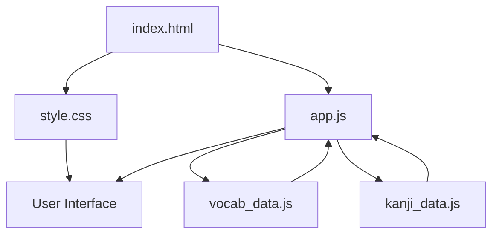

# 🚀 Source Code & Design Structure

> Explore the modular source code behind the application! This directory contains the separated HTML, CSS, and JavaScript files, making the design, functionality, and data structures easier to understand, customize, and develop.

---

## 📑 Table of Contents

- [📌 Overview](#-overview)
- [📂 Folder Structure](#-folder-structure)
- [🧩 File Descriptions](#-file-descriptions)
- [⚙️ Technologies Used](#️-technologies-used)
- [💻 Getting Started](#-getting-started)
- [🎨 Customization Guide](#-customization-guide)
- [🔍 Understanding the Architecture](#-understanding-the-architecture)
- [🤝 Contributions](#-contributions)

---

## 📌 Overview

This folder provides the **modular version of the application**, separating its structure, styling, logic, and datasets into individual files.

While the main application is available as a single HTML file through GitHub Pages, this directory is intended for developers, designers, and curious users who want to explore how the application is built.

**Why a separate source-code version?**

- Clean separation of HTML, CSS, and JavaScript.
- Easier customization of the interface.
- Independent management of application logic and datasets.
- Better readability and maintainability.
- A convenient starting point for further development.

---

## 📂 Folder Structure

```text
files/
│
├── 📄 index.html
├── 🎨 style.css
├── ⚙️ app.js
│
├── 📁 Data/
│   ├── 📜 vocab_data.js
│   └── 📜 kanji_data.js
│
└── 📖 README.md
```

---

## 🧩 File Descriptions

<details>
<summary><strong>📄 index.html — Application Structure</strong></summary>

Contains the base HTML structure of the application.

It defines the layout, interface elements, containers, and the references to the CSS and JavaScript files.

**Responsible for:**
- Page structure and layout.
- HTML components.
- Connecting stylesheets and scripts.

</details>

<details>
<summary><strong>🎨 style.css — Visual Design</strong></summary>

Contains the styling and visual presentation of the application.

**Responsible for:**
- Colors and typography.
- Layout and responsiveness.
- Buttons, cards, and interactive elements.
- Animations and transitions.
- Overall user interface design.

</details>

<details>
<summary><strong>⚙️ app.js — Application Logic</strong></summary>

Contains the primary JavaScript functionality.

**Responsible for:**
- Application interactions.
- Event handling.
- Dynamic content rendering.
- User interaction and state management.
- Connecting the application with its datasets.

</details>

<details>
<summary><strong>📜 vocab_data.js — Vocabulary Dataset</strong></summary>

Stores the vocabulary-related data used by the application.

Keeping vocabulary separate from the main application logic makes it easier to update, expand, and maintain the dataset independently.

</details>

<details>
<summary><strong>📜 kanji_data.js — Kanji Dataset</strong></summary>

Stores the Kanji-related dataset used by the application.

This separation allows the Kanji collection to be maintained and expanded without modifying the core application logic.

</details>

<details>
<summary><strong>📖 README.md — Documentation</strong></summary>

This documentation file explains the project structure, individual components, setup instructions, and customization process.

</details>

---

## ⚙️ Technologies Used

| Technology | Purpose |
|---|---|
| HTML5 | Application structure |
| CSS3 | Styling and responsive design |
| JavaScript | Application functionality |
| Git & GitHub | Version control and hosting |
| GitHub Pages | Application deployment |

---

## 💻 Getting Started

Want to explore or run the application locally?

Follow these steps:

**1. Clone the repository**

```bash
git clone YOUR_REPOSITORY_URL
```

**2. Navigate to the source folder**

```bash
cd YOUR_REPOSITORY_NAME/files
```

**3. Open the application**

Simply open `index.html` in your browser.

Alternatively, use the Live Server extension in Visual Studio Code for a smoother development experience.

**4. Start customizing!**

Modify the HTML, CSS, JavaScript, or datasets according to your requirements.

---

## 🎨 Customization Guide

Want to make the application your own?

| What you want to change | File to edit |
|---|---|
| Page structure | `index.html` |
| Colors and themes | `style.css` |
| Fonts and typography | `style.css` |
| Application functionality | `app.js` |
| Vocabulary collection | `vocab_data.js` |
| Kanji collection | `kanji_data.js` |

---

## 🔍 Understanding the Architecture

The application follows a simple modular architecture:



The HTML provides the structure, CSS handles the presentation, JavaScript powers the functionality, and the dedicated data files provide the content.

---

## 🤝 Contributions

Have ideas to improve the application?

Contributions, suggestions, and improvements are always welcome!

1. Fork the repository.
2. Create a new branch.
3. Make your changes.
4. Submit a Pull Request.

---

<div align="center">

### ⭐ Enjoy exploring the source code?

If you find this project useful, consider giving the repository a **Star**!

**Built with ❤️ and JavaScript.**

</div>

